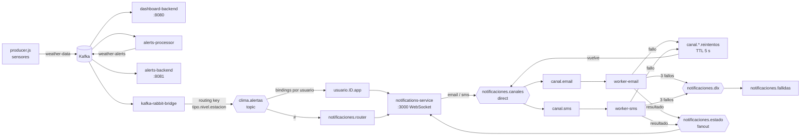

# Clima en tiempo real con Kafka + RabbitMQ

Los sensores envían datos a **Kafka**, que procesa el flujo continuo de mediciones y detecta alertas. Las alertas pasan a **RabbitMQ**, que las reparte como notificaciones a los usuarios suscritos a una app, según la estación, el tipo de alerta y la gravedad que eligió cada uno.

## Por qué los dos

| | Kafka | RabbitMQ |
|---|---|---|
| Papel aquí | Flujo de datos de los sensores | Entrega de notificaciones a personas |
| Modelo | Log distribuido: los mensajes se guardan y se pueden releer | Cola: el mensaje se entrega, se confirma (ack) y desaparece |
| Consumidores | Cada grupo lee todo el topic a su ritmo (offsets) | Enrutamiento por exchange hacia colas concretas |
| Fuerte en | Alto volumen, reprocesar historia, varios lectores independientes | Enrutamiento flexible, colas por usuario, reintentos, DLQ, reparto de trabajo |

Kafka responde a "¿qué pasó en las estaciones?". RabbitMQ responde a "¿a quién hay que avisar, por qué canal y qué hacemos si falla el envío?".

## Arquitectura



### Recorrido de una alerta

1. `producer.js` publica una medición en el topic `weather-data`, con la estación como clave para mantener el orden por partición.
2. `alerts-processor.js` evalúa umbrales y publica en `weather-alerts` una alerta con **tipo** (temperatura, viento, humedad) y **nivel** (amarilla, naranja, roja).
3. `kafka-rabbit-bridge.js` lee la alerta y la publica en el exchange topic `clima.alertas` con la routing key `<tipo>.<nivel>.<estacion>`, por ejemplo `temperatura.roja.STATION-02`. El offset de Kafka solo avanza cuando RabbitMQ confirma que guardó el mensaje (publisher confirms).
4. Cada usuario tiene su propia cola `usuario.<id>.app`, enlazada solo con las routing keys que le interesan. Si está desconectado, RabbitMQ le **guarda** las alertas (hasta 50, durante 1 hora) y se las entrega cuando vuelve a abrir la app.
5. La cola `notificaciones.router` recibe todas las alertas (`#`). Por cada usuario que pidió correo o SMS, genera un trabajo en el exchange direct `notificaciones.canales`.
6. Los workers simulan el envío. Si falla, el mensaje espera 5 s en una cola de reintentos y vuelve. Tras 3 fallos, termina en la Dead Letter Queue `notificaciones.fallidas`.
7. El resultado de cada envío se publica en el fanout `notificaciones.estado` y el usuario lo ve debajo de cada alerta.

## Ejecutar

Si ya tenías levantada la versión anterior, bórrala primero para que los topics se creen con 3 particiones:

```bash
docker-compose down -v
docker-compose up -d --build
docker-compose ps
```

`kafka-init` aparecerá como `Exited (0)`: es normal, crea los topics y termina.

| Qué | Dirección |
|---|---|
| App de notificaciones (suscribirse) | http://localhost:3000 |
| Consola de RabbitMQ (usuario `clima`, clave `clima123`) | http://localhost:15672 |
| Panel del clima | abrir `index.html` |
| Panel de alertas | abrir `alerts.html` |

Logs útiles:

```bash
docker-compose logs -f kafka-rabbit-bridge notifications-service
docker-compose logs -f worker-email worker-sms
```

## Experimentos para clase

**Varios usuarios con filtros distintos.** Abre http://localhost:3000 en una ventana normal y otra en incógnito. Suscribe a uno solo a la estación 01 con nivel roja, y al otro a todas con nivel amarilla. Cada uno recibe solo lo suyo: el filtrado lo hace RabbitMQ con los bindings, no el código. En la consola de RabbitMQ, en *Exchanges → clima.alertas*, se ven todos los bindings.

**Alertas guardadas mientras estás fuera.** Suscríbete, cierra la pestaña un minuto y vuelve a abrir http://localhost:3000. Aparece el aviso de alertas pendientes. En *Queues*, la cola `usuario.<id>.app` muestra los mensajes acumulados mientras estabas desconectado.

**Consumidores competitivos.** Escala los workers de correo y mira cómo RabbitMQ reparte los trabajos (cada envío indica qué worker lo hizo):

```bash
docker-compose up -d --scale worker-email=3
docker-compose logs -f worker-email
```

**Caída de un worker sin perder mensajes.** Detén los workers de SMS, deja pasar unas alertas y vuelve a arrancarlos. Los SMS se acumulan en `canal.sms` y se envían al volver:

```bash
docker-compose stop worker-sms
docker-compose start worker-sms
```

**Reintentos y Dead Letter Queue.** Sube la tasa de fallo en el compose (por ejemplo `TASA_FALLO: "0.8"`) y aplica con `docker-compose up -d`. Verás reintentos y mensajes en `notificaciones.fallidas`, que puedes inspeccionar en la consola con *Get messages*.

**Kafka como historia, RabbitMQ como entrega.** Kafka conserva todas las alertas y un grupo de consumidores nuevo puede releerlas desde el principio. En RabbitMQ, una vez confirmado, el mensaje ya no existe:

```bash
docker-compose exec kafka kafka-console-consumer --bootstrap-server kafka:9092 \
  --topic weather-alerts --from-beginning --max-messages 5
```

## Archivos

| Archivo | Función |
|---|---|
| `producer.js` | Simula 3 estaciones y publica en Kafka |
| `alerts-processor.js` | Kafka → Kafka: detecta alertas con tipo y nivel |
| `dashboard-backend.js`, `alerts-backend.js` | Kafka → WebSocket para los paneles originales |
| `kafka-rabbit-bridge.js` | Kafka → RabbitMQ con publisher confirms |
| `notifications-service.js` | API de suscripción, colas por usuario, router y WebSocket de la app |
| `notification-worker.js` | Worker de correo o SMS (variable `CANAL`) con reintentos y DLQ |
| `rabbit.js` | Conexión y topología compartida de RabbitMQ |
| `public/app.html` | App donde el usuario se suscribe y recibe las alertas |

## Límites de esta demo

Las suscripciones se guardan en un archivo JSON dentro de un volumen; en producción irían en una base de datos. El correo y el SMS son simulados. Las garantías son "al menos una vez": ante un fallo, un usuario podría recibir la misma alerta dos veces (cada alerta lleva un `id` para poder deduplicar).
